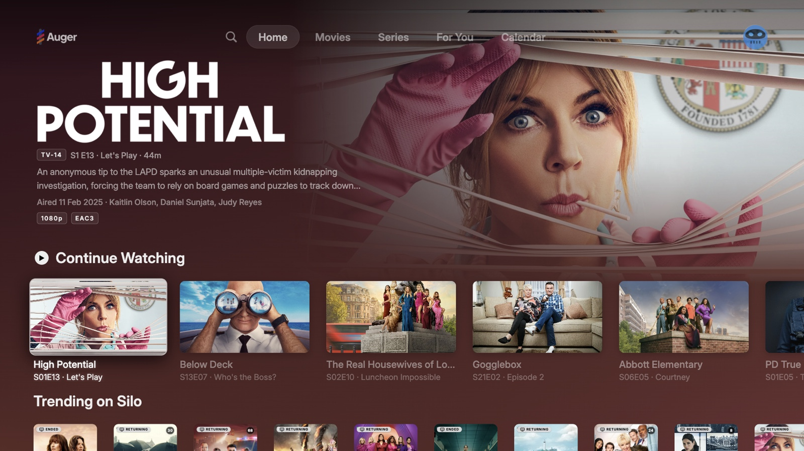

# Auger

<p align="center">
  
</p>

Auger is a third-party Samsung TV client for [Silo](https://siloserver.org), the self-hosted media server.
It is not made by, endorsed by, or affiliated with Silo Media L.L.C.

It is a Tizen web app (`.wgt`) for Samsung TVs running Tizen 8.0 or later.
The installed OS version, not the TV's model year, decides compatibility; earlier Tizen versions are not supported.
[FEATURES.md](FEATURES.md) lists what it does today and tracks parity with Silo's Apple TV app.

## How it works

<p align="center">
  
</p>

1. **Sign in.** Approve a device code from another device, or use a password, then pick a profile and enter its PIN if it has one.
2. **Browse.** Auger reads your libraries through Silo's native `/api/v2`, and nothing else.
3. **Play.** The server plans Direct Play, Remux or an HLS Transcode from what the TV can decode, and Samsung's AVPlay plays it.

## Screenshots

| Home | Movies |
| --- | --- |
|  |  |

| Series Details | Search |
| --- | --- |
|  |  |

## Install

Auger ships through Apps2Samsung and GitHub Releases.
Install it in one of two ways:

- **[Apps2Samsung](https://github.com/Apps2Samsung/Apps2Samsung) (recommended):** open Apps2Samsung, find **Auger** under **Media servers & players**, and install it directly from the official community catalog.
  Apps2Samsung signs `Auger.wgt` with your own Samsung certificate and updates it in one click when a new release ships.
  Do not add this repository as a custom source; doing so creates a duplicate `Unverified · Auger-Tizen` entry alongside the official listing.
- **Sideload from source:** public releases are signed with the Tizen SDK public certificate (no personal TV DUIDs), so direct `tizen install` requires building and signing locally with your own Samsung TV certificate profile; see [Releasing](docs/releasing.md#sideloading-a-build).

The two signatures differ, so to switch between Apps2Samsung and a sideloaded build, in either direction, uninstall the app first.
Upgrading from a `0.1.0-beta.*` build also requires uninstalling first because the Tizen package ID changed to `AugerTv001.Auger`; subsequent builds with `AugerTv001.Auger` update in place within the same install method.
Uninstalling removes its data, so you sign in again afterwards.

## Build from source

You need:

- Node.js 26 or later
- Tizen Studio Web CLI and a Certificate Manager security profile, for packaging
- A running Silo server for sign-in, browsing and playback validation
- A Samsung TV in Developer Mode, or the Samsung TV simulator, for runtime checks

```sh
npm ci
npx playwright install chromium   # browser for the screen tests
npm run build
```

`scripts/build.mjs` stages `app/` into `dist/wgt/` and emits `js/main.js` and `js/main.css`.
The bundle's app version comes from `app/config.xml`.

Tizen 8.0 uses Chromium 108 ([Samsung web engine specifications](https://developer.samsung.com/smarttv/develop/specifications/web-engine-specifications.html)).
TypeScript checks ES2022 and DOM code in strict mode; tests additionally load Node types.
esbuild emits a classic script targeting `chrome108`.
Neither step supplies missing browser APIs or CSS support.

### Test

`npm test` runs both strict type checks, the production build, native contract/session/player tests and Playwright screen/composition tests.
See [test/README.md](test/README.md) for the test boundaries, and [Samsung simulator evidence](docs/evidence/simulator-evidence.md) for the simulator recipe, signed-package identity checks and Apple TV comparisons.

### Sign, package, and release

Packaging signs `dist/Auger.wgt` with a local Tizen Studio Certificate Manager security profile (`export TIZEN_SECURITY_PROFILE="YourProfileName" && ./scripts/build-wgt.sh`).
Keep certificates, profile XML, and passwords outside Git.
CI packages PR and `main` builds with the Tizen SDK public distributor certificate (`.github/workflows/tizen-build.yml`), and the Release workflow tags `vX.Y.Z` and publishes `Auger.wgt` on GitHub Releases; see [Releasing](docs/releasing.md) for signing, Apps2Samsung, and sideloading details.

For repository layout, canonical domain terms, and full documentation pointers, see [AGENTS.md](AGENTS.md) and [docs/README.md](docs/README.md).

## Contributing

Right now, the most helpful way to contribute is a clear, accurate issue.
Pull requests are welcome when accompanied by an issue; we close other pull requests without review.
See [CONTRIBUTING.md](CONTRIBUTING.md) for issue guidelines, validation steps, and pull request conventions, and [docs/reporting-bugs.md](docs/reporting-bugs.md) for where to find your TV model, Auger version, and the player's **Stats** tab.

Problems with the server or its API belong in [silo-server](https://github.com/Silo-Server/silo-server/issues/new/choose), not here.

## Credits

- **Silo.** Auger is an independent client for [Silo](https://siloserver.org).
- **Silo's TV apps.** The interface follows Silo's [Skyline design guide](https://github.com/Silo-Server/silo-apple/blob/main/docs/skyline-design-guide.md).
  Behavior is ported from [silo-apple](https://github.com/Silo-Server/silo-apple) and compared with [silo-android](https://github.com/Silo-Server/silo-android).

## License and trademarks

Auger is licensed under `AGPL-3.0-or-later`; see [LICENSE](LICENSE).
An additional permission under AGPL section 7 allows combining it with platform SDKs; see [PLATFORM-EXCEPTION.md](PLATFORM-EXCEPTION.md).

Silo and the Silo logo are trademarks of Silo Media L.L.C.

The Auger mark and wordmark are this project's own artwork.
[TRADEMARK.md](TRADEMARK.md) summarizes Auger's trademark notice and links to Silo's canonical policy.

Samsung, Tizen, Apple TV, TMDB and other names belong to their owners.
Third-party code, fonts and marks retain their own licenses; see [THIRD_PARTY_NOTICES.md](THIRD_PARTY_NOTICES.md).
