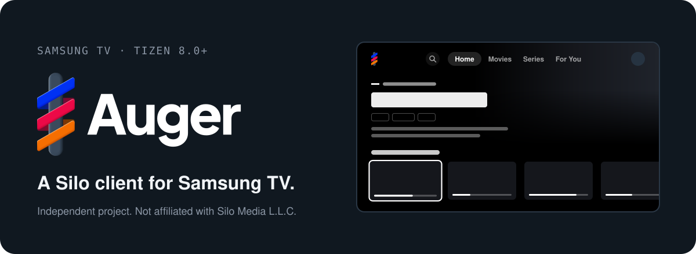

# Auger

<p align="center">
  
</p>

Auger is a third-party Samsung TV client for [Silo](https://siloserver.org), the self-hosted media server.
It is not made by, endorsed by, or affiliated with Silo Media L.L.C.

It is a Tizen web app (`.wgt`) for Samsung TVs running Tizen 8.0 or later.
The installed OS version, not the TV's model year, decides compatibility; earlier Tizen versions are not supported.
[FEATURES.md](FEATURES.md) lists what it does today and tracks parity with Silo's Apple TV app.

## How it works

<p align="center">
  
</p>

1. **Sign in.** Approve a device code from another device, or use a password, then pick a profile and enter its PIN if it has one.
2. **Browse.** Auger reads your libraries through Silo's native `/api/v2`, and nothing else.
3. **Play.** The server plans Direct Play, Remux or an HLS Transcode from what the TV can decode, and Samsung's AVPlay plays it.

## Install

Auger is not in the Samsung TV store and will not be submitted to it.
Install it in one of two ways:

- **[Apps2Samsung](https://github.com/Apps2Samsung/Apps2Samsung):** add this repository as a source (`github.com/Artic0din/Auger`), then install from it.
  Apps2Samsung signs the app with your own Samsung certificate, so it installs on your TV without being listed in ours.
  It updates in one click when the app's version changes.
  It compares the version (for example `0.1.0`), not the build number, so to get a newer build of the same version, install it again from the source.
- **Sideload:** download a versioned build and its `.sha256` checksum from [Releases](https://github.com/Artic0din/Auger/releases).
  It is signed with the maintainer's certificate, so it installs only on TVs listed in it; see [Releasing](docs/releasing.md#sideloading-a-build).

The two signatures differ, so to switch between Apps2Samsung and a sideloaded build, in either direction, uninstall the app first.
Uninstalling removes its data, so you sign in again afterwards.

## Build from source

You need:

- Node.js 26 or later
- Tizen Studio Web CLI and a Certificate Manager security profile, for packaging
- A running Silo server for sign-in, browsing and playback validation
- A Samsung TV in Developer Mode, or the Samsung TV simulator, for runtime checks

```sh
npm ci
npx playwright install chromium   # browser for the screen tests
npm run build
```

`scripts/build.mjs` stages `app/` into `dist/wgt/` and emits `js/main.js` and `js/main.css`.
The bundle's app version comes from `app/config.xml`.

Tizen 8.0 uses Chromium 108 ([Samsung web engine specifications](https://developer.samsung.com/smarttv/develop/specifications/web-engine-specifications.html)).
TypeScript checks ES2022 and DOM code in strict mode; tests additionally load Node types.
esbuild emits a classic script targeting `chrome108`.
Neither step supplies missing browser APIs or CSS support.

### Test

`npm test` runs both strict type checks, the production build, native contract/session/player tests and Playwright screen/composition tests.
See [test/README.md](test/README.md) for the test boundaries, and [Samsung simulator evidence](docs/evidence/simulator-evidence.md) for the simulator recipe, signed-package identity checks and Apple TV comparisons.

### Sign and package

Packaging signs with a Tizen Studio Certificate Manager security profile.
Never commit certificates, profile XML or passwords.

```sh
export TIZEN_SECURITY_PROFILE="YourProfileName"
./scripts/build-wgt.sh
```

The script builds the package staging directory and writes `dist/Auger.wgt`.

CI builds the same package on every pull request and push to main (`.github/workflows/tizen-build.yml`).
On main and same-repository pull requests it signs with the maintainer's Samsung certificate from repository secrets and uploads `Auger.wgt` with its SHA-256 as the `silo-tizen-wgt` artifact.
That certificate lists the TVs it may install on, so a CI-signed package installs only on those TVs.

### Release

Builds are made by the Release workflow from `main` and published on GitHub Releases; see [Releasing](docs/releasing.md).

<details>
<summary>Repository layout</summary>

- `app/` holds the package manifest (`config.xml`), HTML entry, icon, fonts, and third-party marks.
- `src/api/`, `src/session/`, and `src/contracts/v2/` own `/api/v2` transport, sessions, active Profile Authority, and contract decoders.
- `src/ui/` owns screens and remote focus; `src/player/` owns AVPlay playback.
- `scripts/` holds build, packaging, fixture sync, and release scripts; `test/` holds native and Playwright screen tests.
- `assets/readme/` holds the images on this page.
- [GLOSSARY.md](GLOSSARY.md) and [docs/domain-model.md](docs/domain-model.md) define canonical terms and entity rules.
- `docs/` holds behavior, focus, API, feature, and validation docs; use [docs/README.md](docs/README.md) as the index and [docs/app-behaviour.md](docs/app-behaviour.md) for current runtime behavior.
- [AGENTS.md](AGENTS.md) holds coding-agent context pointers, platform invariants, and parity gates.

</details>

## Contributing

Right now, the most helpful way to contribute is a clear, accurate issue.
We implement and review changes through our own workflow, and pull request volume has outgrown what we can review carefully, so a good issue usually helps us more than a pull request.

Pull requests are still welcome from contributors who've had one merged in a Silo repository, or when a maintainer asks for one.
We close other pull requests without review.
[CONTRIBUTING.md](CONTRIBUTING.md) explains what makes an issue useful.

Problems with the server or its API belong in [silo-server](https://github.com/Silo-Server/silo-server/issues/new/choose), not here.

## Credits

- **Silo.** Auger exists because of [Silo](https://siloserver.org), built by Silo Media L.L.C. and its contributors.
  Auger began as Silo's own Samsung TV client and is now maintained independently.
- **Silo's TV apps.** The interface follows Silo's [Skyline design guide](https://github.com/Silo-Server/silo-apple/blob/main/docs/skyline-design-guide.md).
  Behavior is ported from [silo-apple](https://github.com/Silo-Server/silo-apple) and compared with [silo-android](https://github.com/Silo-Server/silo-android), both under the same AGPL license.
- **Silo's brand page.** The Auger mark's three signal colors and the wordmark's typeface match the ones on [siloserver.org/brand](https://siloserver.org/brand).
  The mark itself is a different shape, as that page asks of clients.
  The wordmark is set in Plus Jakarta Sans, under the SIL Open Font License, and converted to outlines.
- **[Apps2Samsung](https://github.com/Apps2Samsung/Apps2Samsung)** makes installing without the store practical.
- **Libraries, fonts and marks.** uqr, unicode-segmenter, ThumbHash, Inter, Roboto Mono and the TMDB logo keep their own licenses; see [THIRD_PARTY_NOTICES.md](THIRD_PARTY_NOTICES.md).

## License and trademarks

Auger is licensed under `AGPL-3.0-or-later` with an additional permission under AGPL section 7 allowing distribution through the Samsung TV Apps store despite its signing, DRM, and redistribution terms.
See [LICENSE](LICENSE) and [APPSTORE-EXCEPTION.md](APPSTORE-EXCEPTION.md).
A second additional permission allows combining it with platform SDKs; see [PLATFORM-EXCEPTION.md](PLATFORM-EXCEPTION.md).

Silo and the Silo logo are trademarks of Silo Media L.L.C.
Auger uses the Silo name only to say what it connects to, which Silo's [trademark policy](https://github.com/Silo-Server/siloserver.org/blob/main/TRADEMARK.md) and [brand guidelines](https://siloserver.org/brand#usage) allow without permission.
Auger is not an official Silo product, and Silo Media L.L.C. does not operate, sponsor or endorse it.
Official Silo software comes only from the [Silo-Server](https://github.com/Silo-Server) organization on GitHub, [siloserver.org](https://siloserver.org), and app-store listings published by Silo Media L.L.C.

The Auger mark and wordmark are this project's own artwork, and this repository ships no Silo logo, wordmark or icon files.
[TRADEMARK.md](TRADEMARK.md) keeps a copy of Silo's policy for reference.

Samsung, Tizen, Apple TV, TMDB and other names belong to their owners.
Third-party code, fonts and marks retain their own licenses; see [THIRD_PARTY_NOTICES.md](THIRD_PARTY_NOTICES.md).
