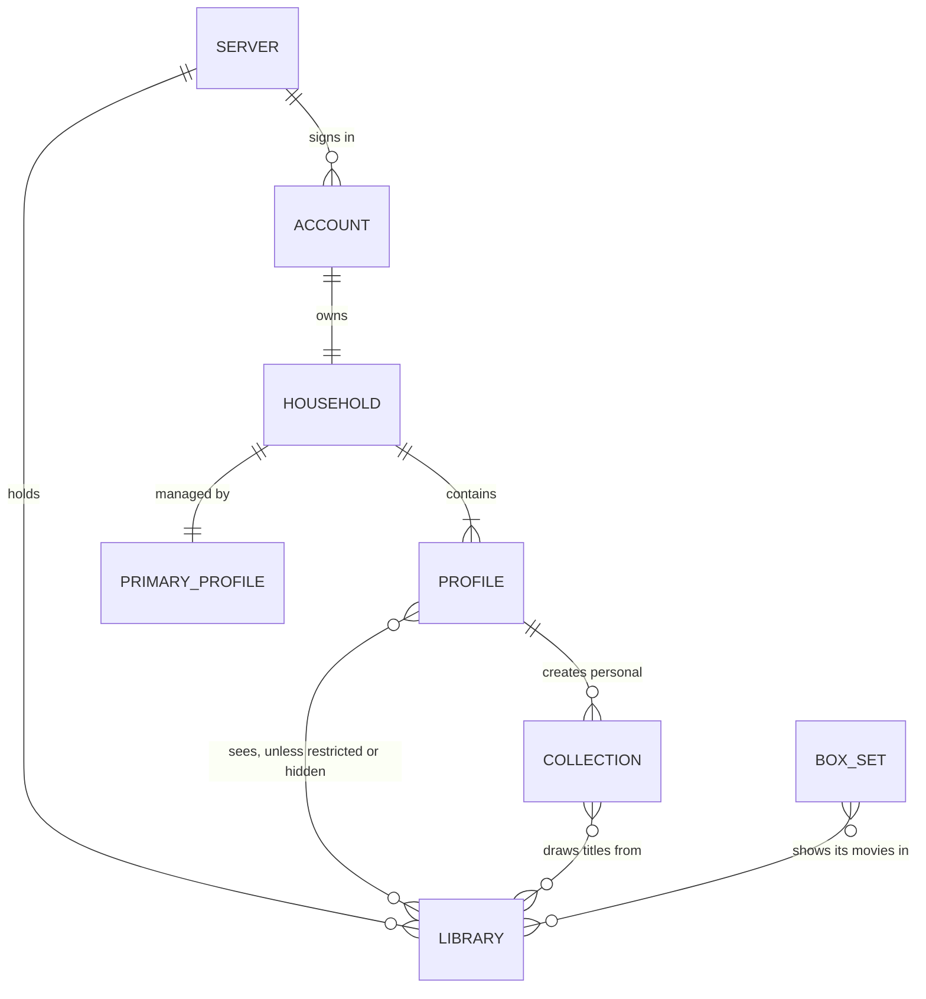
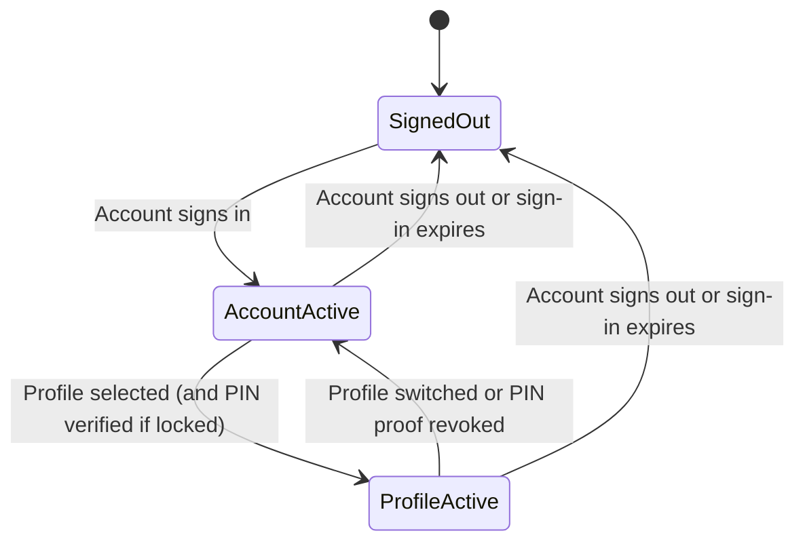

# Domain Model

How the concepts in [GLOSSARY.md](../GLOSSARY.md) connect, change state, and constrain each other in Auger for Samsung TV.
Use [GLOSSARY.md](../GLOSSARY.md) for canonical term definitions.

## Entities and Relationships

- A **Server** holds **Libraries** and signs in **Accounts**.
- An **Account** is scoped to one **Server**; the same username on two **Servers** is two distinct **Accounts**.
- The TV can remember multiple **Accounts** across one or more **Servers**, but only one **Account** and one **Profile** are active at a time.
- Each **Account** owns exactly one **Household**; two **Accounts** on the same **Server** never share **Profiles**.
- A **Household** contains one **Primary Profile** and zero or more additional **Profiles**.
- The **Primary Profile** manages its **Household** (adding **Profiles** and setting restrictions); being the **Primary Profile** does not make it a **Server** administrator.

## Authority Lifecycle

- **Authority** belongs to the single active **Profile** on the TV.
- Any **Authority** change (switching **Profiles**, revoking a PIN proof, signing out, or an expired sign-in) immediately invalidates in-flight browsing and playback work started under the prior **Authority**.
- When **Authority** ends, the TV clears the prior **Profile**'s screens before another **Profile** can act, so late responses never leak across **Profiles** or **Accounts**.

## Catalog Visibility and Grouping

- A **Profile** sees the **Libraries** allowed to its **Account** and **Profile**, minus its **Hidden Libraries**.
- **Restricted Libraries** are barred by access policy — either by a **Server** administrator for an **Account** (affecting every **Profile** in the **Household**), or by the **Primary Profile** for a **Profile** inside its **Household**; the restricted **Profile** cannot undo them.
- **Hidden Libraries** are chosen by the **Profile** itself to hide from its browsing, search, and navigation tabs; that **Profile** can restore them from the TV or another client.
- A **Collection** is either curated on the **Server** or created as a personal **Collection** by a **Profile**, and either can span **Libraries**.
- A personal **Collection** is editable only by its creator **Profile**; when shared, other **Profiles** in the same **Household** see it read-only, and other **Accounts** never see it.
- A **Box Set** has one identity on the **Server** and can span multiple **Libraries**; when viewed inside a **Library**, it shows only that **Library**'s movies.

## What Plays Next

- **Continue Watching** belongs to the active **Profile**'s Home screen and, in the default combined mode, merges in-progress titles with next-up episodes.
- **Next Up** appears as its own Home row only when the **Profile** splits it out from **Continue Watching**.
- **Up Next** is the player panel shown as the current title nears its end or finishes.
- For an episode, **Up Next** follows the series to its next playable episode (crossing regular season boundaries; specials do not advance into regular seasons) and auto-plays only when enabled by this TV's override, falling back to the **Profile**'s effective autoplay setting.
- **Up Next** also displays the **On Deck** row of other playable titles drawn from the **Profile**'s Home rows (**Continue Watching** and **Next Up**), excluding the current title and its series.
- After a movie, or when a series has no next episode, **Up Next** uses the first **On Deck** title as its primary offer.
- **On Deck** titles always require explicit **Viewer** selection and never auto-play.

## Playback Delivery

- The **Server** chooses between **Direct Play**, **Remux**, and **Transcode** from the TV's declared capabilities, effective quality or bitrate limits, buffering step-downs, and subtitle burn-in needs; the TV does not pick the delivery mode itself.
- Playback progress and resume state belong to the active **Profile**; resuming skips near the end of a title so a finished title does not immediately end again.
