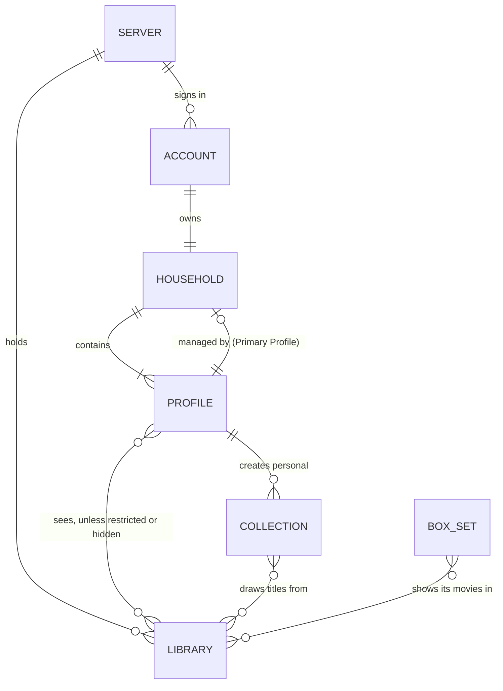
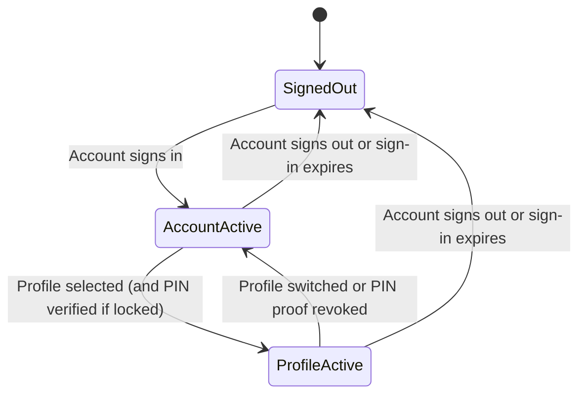

# Domain Model

Entity relationships, state transitions, and behavioral constraints connecting the canonical terms in [GLOSSARY.md](../GLOSSARY.md).

## Entities and Relationships

- An **Account** is scoped to one **Server**; the same username on two **Servers** is two distinct **Accounts**.
- Only one **Account** and one **Profile** are active on the TV at a time, even when multiple **Accounts** are saved.
- Each **Household** contains one **Primary Profile** and zero or more additional **Profiles**.

## Authority Lifecycle

- Every **Authority** transition immediately invalidates and aborts in-flight browsing and playback requests started under the prior **Authority**.
- When **Authority** ends, the TV clears the prior **Profile**'s screens before another **Profile** can act, preventing cross-profile or cross-account response leaks.

## Catalog Visibility and Grouping

- Visible **Libraries** equal the **Libraries** allowed by Server and Household access policy minus the active **Profile**'s **Hidden Libraries**.
- Personal **Collections** are editable only by their creator **Profile**; shared personal **Collections** are read-only for other **Profiles** in the same **Household** and invisible to other **Accounts**.

## What Plays Next

- For an episode, **Up Next** advances across regular season boundaries (specials advance only within specials) and auto-plays only when enabled by this TV's override, falling back to the **Profile**'s effective autoplay setting.
- **Up Next** builds **On Deck** from the active **Profile**'s **Continue Watching** (including any split in-progress row) and **Next Up** rows, excluding the current title and its series.
- **On Deck** titles always require explicit **Viewer** selection and never auto-play.

## Playback Delivery

- The **Server** selects **Direct Play**, **Remux**, or **Transcode** from the TV's declared capabilities, effective quality or bitrate limits, buffering step-downs, and subtitle burn-in requirements; the TV never picks the delivery mode locally.
- Playback progress and resume state belong to the active **Profile**, skipping resume within 5 s of the title's end.
